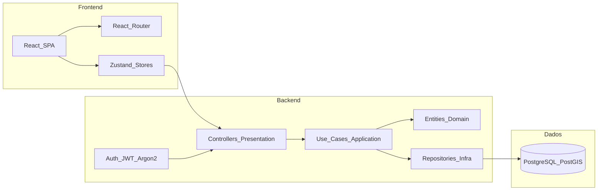
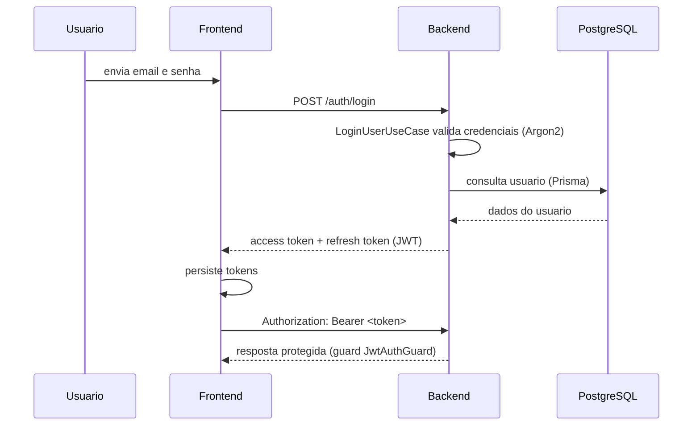

# 🏗️ Arquitetura

## Visão Macro

O projeto segue uma arquitetura **web desacoplada**, com frontend e backend em repositórios separados.



## Repositórios

| Repositório               | Descrição                                      |
| ------------------------- | ---------------------------------------------- |
| `backend-biota-geom`      | API REST e regras de negócio (NestJS + Prisma) |
| `frontend-biota-geom`     | Interface web da plataforma (React + Vite)     |
| `backend-biota-geom/wiki` | Documentação do projeto                        |

## Backend

Stack: **Node.js**, **TypeScript**, **NestJS**, **PostgreSQL/PostGIS**, **Prisma**, **Docker Compose**, **Swagger**.

### Estilo Arquitetural

O backend segue uma arquitetura em camadas por módulo (Clean/Hexagonal), organizada dentro de `src/modules/<módulo>`:

| Camada         | Pasta           | Responsabilidade                                                           |
| -------------- | --------------- | -------------------------------------------------------------------------- |
| `presentation` | `presentation/` | Controllers REST, DTOs de entrada/saída, filtros de exceção, guards        |
| `application`  | `application/`  | Use cases: orquestração das regras de negócio                              |
| `domain`       | `domain/`       | Entidades, interfaces de repositório (portas) e erros de domínio           |
| `infra`        | `infra/`        | Implementações concretas (Prisma repositories, serviços externos, mappers) |
| `config`       | `src/config/`   | Validação de variáveis de ambiente                                         |
| `common`       | `src/common/`   | Throttling e validação compartilhadas entre módulos                        |
| `prisma`       | `src/prisma/`   | Módulo/serviço de acesso ao Prisma Client                                  |

Cada módulo (`auth`, `customers`, `esg-metrics`, `sectors`, `users`) declara suas próprias camadas e injeta as implementações de `infra` nas interfaces definidas em `domain` (padrão porta/adaptador), por exemplo:

```ts
providers: [
  { provide: CustomerRepository, useClass: PrismaCustomerRepository },
  ListCustomersUseCase,
  RemoveCustomerUseCase,
];
```

### Módulos e Endpoints

| Módulo        | Rota base          | Endpoints                                                   |
| ------------- | ------------------ | ----------------------------------------------------------- |
| `auth`        | `/auth`            | `POST /register`, `POST /login`, `POST /refresh`, `GET /me` |
| `customers`   | `/customers`       | `GET /`, `DELETE /:id` (soft delete)                        |
| `esg-metrics` | `/api/esg-metrics` | `GET /`, `POST /`                                           |
| `sectors`     | —                  | Entidade de domínio consumida por `customers`               |
| `users`       | —                  | Domínio de usuário, usado pelo módulo `auth`                |

### Fluxo de Requisição (Login)



### Banco de Dados

Modelagem via Prisma (`prisma/schema.prisma`), com PostGIS habilitado para dados geoespaciais:

- `users`: contas de acesso (admin/cliente), com hash de senha via Argon2.
- `customers`: clientes da plataforma, com soft delete (`isDeleted`) e vínculo opcional a `sectors` e `customer_address`.
- `sectors`: setores de atuação dos clientes.
- `esg_metric`: métricas ESG (pilares Ambiental/Social/Governança), globais ou por cliente.

### Qualidade

- Lint (ESLint) + formatação (Prettier) + typecheck (TypeScript) + testes unitários (Jest) rodam no CI (`quality.yml`) a cada PR e push em `main`.
- Cobertura mínima de 85% (statements/functions/lines/branches) nos arquivos `.ts` alterados, com folga de 70% em branches para arquivos decorados (`@Injectable()`, `@Controller()`, etc).
- `docker-build.yml` valida o build multi-stage da imagem Docker a cada PR.

## Frontend

Stack: **React 19**, **TypeScript** (modo estrito), **Vite**, **Tailwind CSS 4**, **shadcn/ui** (sobre Radix UI), **React Router DOM**, **Vitest + Testing Library**.

### Estrutura Principal

| Pasta             | Responsabilidade                                               |
| ----------------- | -------------------------------------------------------------- |
| `src/app/`        | Configuração global e rotas (`router/routes.ts`)               |
| `src/features/`   | Código organizado por domínio de negócio                       |
| `src/pages/`      | Páginas associadas às rotas                                    |
| `src/components/` | Componentes compartilhados (`ui/shadcn` = gerados pela CLI)    |
| `src/services/`   | Estrutura para integrações futuras com o backend               |
| `src/styles/`     | Entrada global e tokens do tema Tailwind                       |
| `src/utils/`      | Utilitários compartilhados                                     |
| `src/tests/`      | Testes espelhando a pasta de origem (Vitest + Testing Library) |

### Rotas Preparadas

- `/login`
- `/admin/companies`
- `/admin/legislation`
- `/admin/indicators`
- `/companies/:companyId/dashboard`
- `/companies/:companyId/licenses`
- `/companies/:companyId/licenses/:licenseId`
- `/companies/:companyId/obligations`
- `/companies/:companyId/legislation`
- `/companies/:companyId/indicators`
- `/companies/:companyId/documents`

Fluxos de criação são modais abertos nas páginas de contexto — não há rotas `/new`.

### Qualidade

- Cobertura de linha mínima de 80% nas alterações (`test:coverage` / `coverage:changed`).
- Testes de mutação com StrykerJS (score atual: 94,5%), garantindo que os testes verificam comportamento e não apenas executam código.
- Dados temporários de navegação usam sufixo `.mock.ts` e prefixo `MOCK_`, para não serem confundidos com integração real.

### Status

Projeto em fase inicial: arquitetura, navegação e identidade visual já preparadas; funcionalidades de negócio e integração real com o backend ainda serão implementadas.
